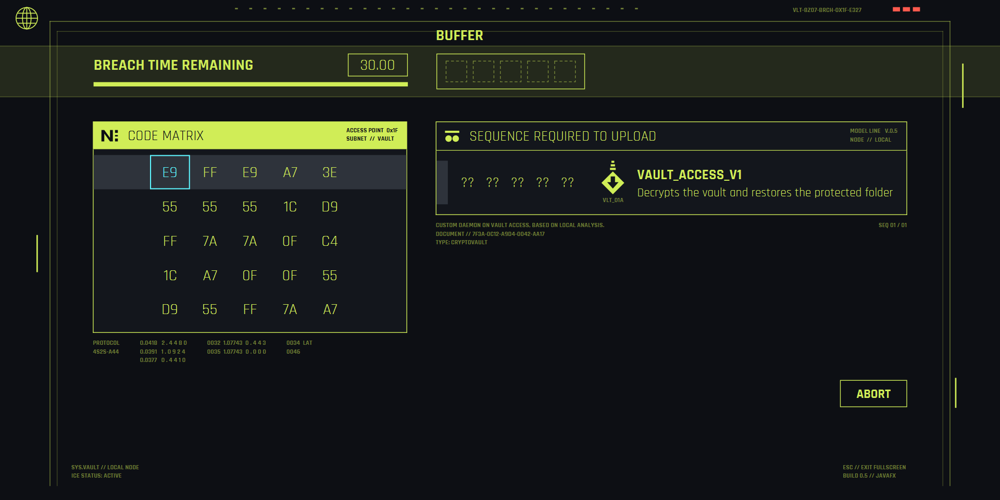
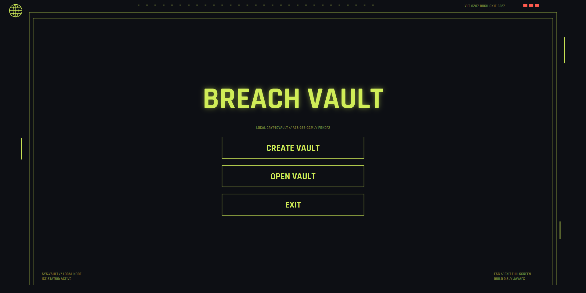
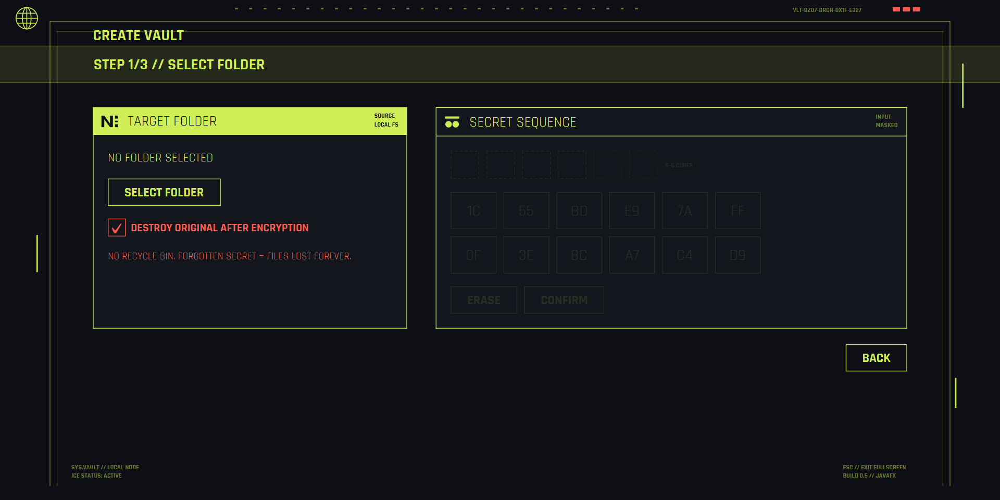
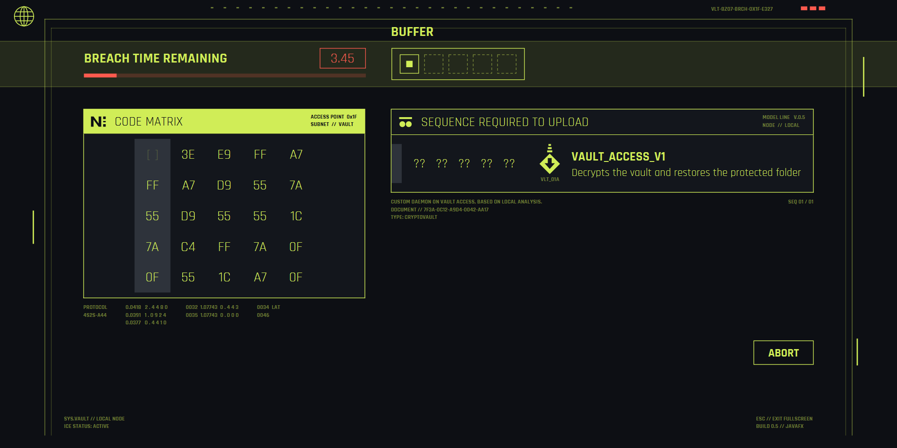
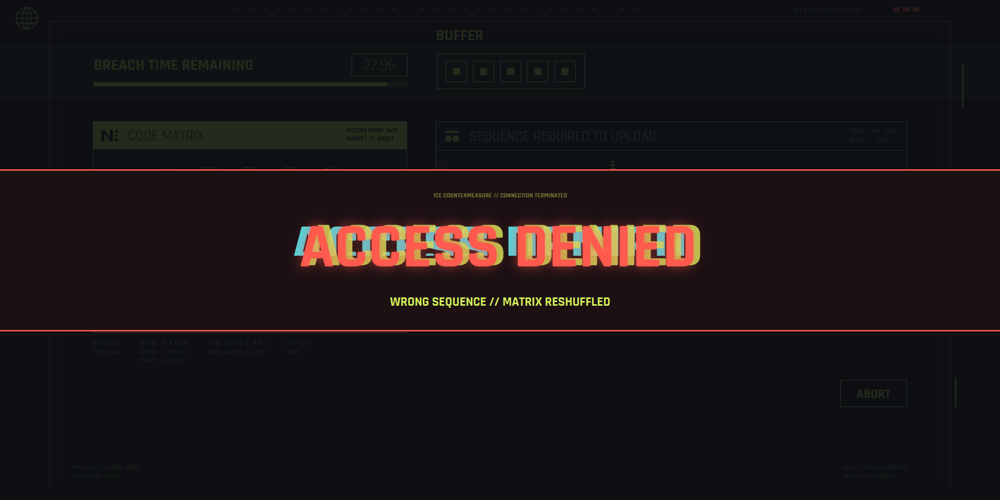
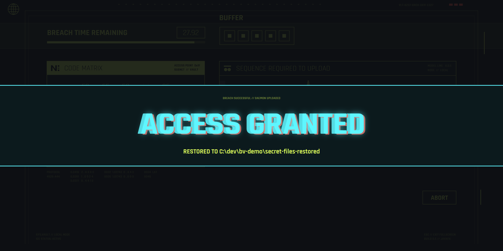
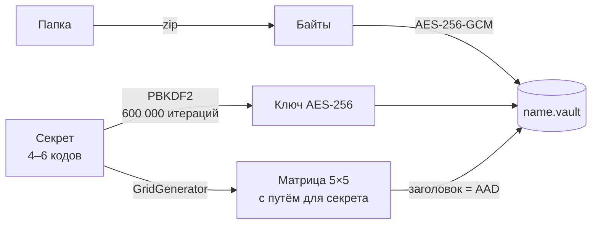
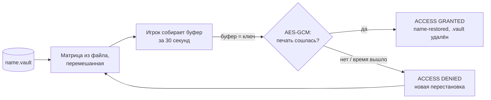

<div align="center">


# BREACH VAULT

**Файловый сейф, который открывается взломом.**
Папка шифруется в `.vault`, а чтобы её вернуть, нужно пройти мини-игру в духе Breach Protocol
из Cyberpunk 2077 — успеть за 30 секунд собрать в матрице кодов правильную последовательность.




</div>

---

## Что это

Учебный проект на Java: настоящий шифровальщик папок (PBKDF2 + AES-256-GCM) с интерфейсом-игрой.

1. **Создаёшь сейф.** Выбираешь папку, придумываешь секрет — последовательность из 4–6 кодов
   (`1C`, `55`, `BD`, `E9`, …) — и вводишь его дважды. Рядом с папкой появляется `<имя>.vault`.
   По желанию оригинал уничтожается.
2. **Открываешь сейф.** Двойной клик по `.vault` — и сразу матрица 5×5. Ходы чередуются:
   первый — в строке 0, следующий — в столбце выбранной клетки, потом снова в строке…
   Собрал свой секрет до конца таймера — **ACCESS GRANTED**, папка восстановлена, `.vault` удалён.
   Ошибся или не успел — **ACCESS DENIED** и перемешанная матрица.

Кто не знает секрет — видит ту же матрицу, но не знает, какой путь в ней правильный.

## Экраны

<table>
  <tr>
    <td width="50%"><br><sub><b>Меню.</b> Полноэкранный режим, холст 1400×700 масштабируется под любой монитор.</sub></td>
    <td width="50%"><br><sub><b>Создание.</b> Секрет вводится на панели из 12 кодов и не показывается — только закрашенные слоты.</sub></td>
  </tr>
  <tr>
    <td><br><sub><b>Взлом.</b> Активная линия — тёмная полоса, клетка под курсором — в голубой рамке.</sub></td>
    <td><br><sub><b>Последние 5 секунд.</b> Таймер и полоса краснеют, число мигает.</sub></td>
  </tr>
  <tr>
    <td><br><sub><b>ACCESS DENIED.</b> Глитч: текст расслаивается на цветные копии, полосы «съезжают».</sub></td>
    <td><br><sub><b>ACCESS GRANTED.</b> Файлы распакованы в <code>&lt;имя&gt;-restored</code>.</sub></td>
  </tr>
</table>

## Возможности

- 🔐 **Шифрование:** ключ из секрета через PBKDF2-HMAC-SHA256 (600 000 итераций, соль 16 байт),
  данные — AES-256-GCM (IV 12 байт, новый при каждом шифровании). Секрет нигде не хранится.
- 🧩 **Матрица с гарантированным путём:** при создании сейфа строится сетка, в которой секрет точно
  можно собрать по правилам игры.
- 🔀 **Честная «новая» матрица:** после неудачи столбцы и строки 1–4 перемешиваются. Набор собираемых
  последовательностей при этом *не меняется* — новых подсказок нет (это проверяет тест).
- 🛡️ **Защита заголовка:** матрица лежит в файле открыто, но подписана вместе с данными (GCM AAD) —
  подмена хоть одной клетки ломает расшифровку.
- 🗑️ **Уничтожение оригинала по галочке** — только после проверки: `.vault` перечитывается с диска,
  расшифровывается и сравнивается с папкой байт в байт.
- ☁️ **Без OneDrive:** папки и сейфы внутри OneDrive не обрабатываются — удалённое там остаётся
  в облачной корзине и истории версий.
- 🔊 **Звуки** наведения, нажатия, открытия матрицы и результата — синтезируются прямо в коде, без файлов.
- 🖱️ **Двойной клик по `.vault`** открывает программу сразу на матрице (`.exe` со своей Java внутри).

## Как это устроено

**Создание сейфа**



**Открытие сейфа**



**Почему перемешивание ничего не выдаёт.** Если переставить столбцы и строки 1…N-1 (строка 0 остаётся
первой), клетки одной строки остаются в одной строке, клетки одного столбца — в одном столбце.
Любой путь по правилам переходит в путь с теми же кодами, и наоборот. Матрица выглядит новой,
а множество собираемых последовательностей — то же самое.

**Формат файла `.vault` (v2)**

| Байты | Поле |
|---|---|
| 4 | `BVLT` — признак «это наш файл» |
| 1 | версия = 2 |
| 1 | размер матрицы N |
| 1 | длина секрета |
| N×N×2 | матрица, коды по 2 ASCII-символа |
| 16 | соль PBKDF2 |
| 12 | IV для GCM |
| остальное | zip папки, зашифрованный AES-256-GCM, + 16 байт tag |

Всё до IV передаётся в GCM как AAD. Старые файлы v1 (без матрицы) тоже открываются — через ввод секрета.

## Честно про стойкость

Это **учебный** сейф. Матрица лежит в файле открыто, поэтому атакующему достаточно перебрать
пути по ней: около 300 вариантов для секрета из 4 кодов и около 5 000 для 6. С PBKDF2 это минуты,
а не годы. Не храните так настоящие данные.

## Запуск

Нужна **Java 21** (JDK). Gradle ставить не надо — в проекте есть wrapper.

> ⚠️ Кладите проект в путь **без кириллицы** и **вне OneDrive**, например `C:\dev\breach-vault`.
> С кириллицей в пути Gradle не может запустить тесты.

```powershell
.\gradlew.bat run           # запустить
.\gradlew.bat test          # тесты
.\gradlew.bat packageApp    # собрать BreachVault.exe со встроенной Java
```

**Установка в Windows** (ярлык на рабочем столе + открытие `.vault` двойным кликом, без прав администратора):

```powershell
.\gradlew.bat packageApp
powershell -ExecutionPolicy Bypass -File tools\install-windows.ps1
# удалить: tools\uninstall-windows.ps1
```

Выход из полноэкранного режима — `Esc`.

## Структура

```
src/main/java/breachvault/
├── app/      BreachVaultApp — точка входа, флаг DEBUG_SAVE_SECRETS
├── game/     Grid, BreachGame (правила), GridGenerator (путь + перемешивание)
├── crypto/   KeyDeriver (PBKDF2), AesGcmCipher (AES-256-GCM + AAD)
├── vault/    VaultService (lock/unlock/verify/destroy), VaultFile, Zipper, OneDriveGuard
└── ui/       экраны JavaFX, GlitchText, ResultOverlay, Synth + Sounds
src/main/resources/breachvault/   neon.css, шрифт Rajdhani, иконки
tools/                            иконка, установка и удаление в Windows
test-data/                        безопасные файлы для экспериментов
```

## Тесты

48 тестов JUnit 5: правила хода и тупики, генератор матрицы (500 случайных сеток прогоняются через
настоящую игру), инвариант перемешивания, шифрование и подмена данных, полный цикл
«зашифровать → проверить → уничтожить → расшифровать» на копии `test-data` во временной папке,
защита от Zip Slip, громкость и чистота звуков.

## Благодарности

- Вдохновлено мини-игрой Breach Protocol из **Cyberpunk 2077**. Это фанатский учебный проект,
  не связанный с CD PROJEKT RED. Графика, иконки и звуки нарисованы и синтезированы с нуля.
- Шрифт [Rajdhani](https://fonts.google.com/specimen/Rajdhani) — Indian Type Foundry,
  лицензия SIL Open Font License (`src/main/resources/breachvault/fonts/OFL.txt`).

## Лицензия

Код — [MIT](LICENSE): бери, меняй, используй как хочешь, только сохрани строку с копирайтом.
Шрифт Rajdhani остаётся под своей лицензией OFL.
